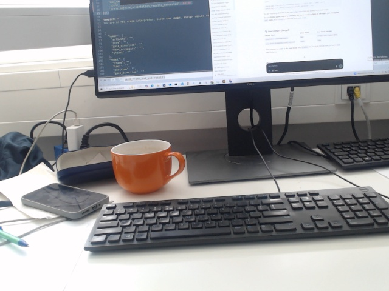
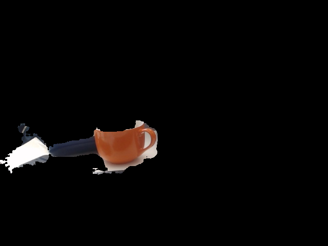

# Event-Triggered Visual Reasoning

**Use changes in the person and background to select when, and what, a vision-language model should inspect.**

For interactive perception, sending every camera frame to a large vision-language model can be unnecessary. This exploratory prototype uses person segmentation and CLIP image embeddings to detect changes in different scene regions, then optionally routes the selected image to LLaVA.

`Vision-language models` · `CLIP` · `MediaPipe` · `LLaVA` · `Change detection`

## Real-world diagnostic example

The current implementation was run on four archived camera snapshots of a desk. The first image established a reference; the next three were processed in filename order using MediaPipe and CLIP with a cosine-distance threshold of **0.1**. These are separate still images, captured over several minutes, with changes in viewpoint and exposure. LLaVA was not used in this run.

| Input frame, sample 2 | Corresponding person-region view |
| :---: | :---: |
|  |  |

*Unaltered views saved by the capture-report script. The dark region in the person view consists of pixels masked out by the segmentation step.*

The person-region view includes a mug and nearby desk objects even though no full person is visible. This segmentation error affects the CLIP embedding and contributes to the selected routes. It is a concrete failure case that motivates checking mask quality before interpreting a region change as a human event.

| Sample | Person distance | Background distance | Full-frame distance | Selected region |
| --- | ---: | ---: | ---: | --- |
| 0 | — | — | — | Baseline |
| 1 | 0.189 | 0.093 | 0.031 | Person |
| 2 | 0.227 | 0.153 | 0.077 | Full frame |
| 3 | 0.171 | 0.137 | 0.044 | Full frame |

Distances are computed against each region's stored reference, which is refreshed after a corresponding event; they are not necessarily distances to the immediately preceding image. The threshold is applied to the person and background distances. These four samples demonstrate behavior on this particular input, not measured accuracy, latency, or model-call savings. [Run metadata and unrounded distances](examples/desk-diagnostic/desk_diagnostic.json).

## Pipeline

**Frame → person/background segmentation → CLIP embeddings → change gate → selected view → optional LLaVA**

If neither region crosses the change threshold, the gate emits no event.

Each sampled frame is encoded as a full image, a person-only image, and a background-only image. Masked pixels are black. The gate compares each region embedding with its stored reference using cosine distance:

$$
d_r = 1 - \frac{e_r \cdot e_r^{\mathrm{ref}}}{\lVert e_r \rVert \cdot \lVert e_r^{\mathrm{ref}} \rVert}
$$

The first sample sets the references. Person and background distances determine the route when they are greater than a threshold; the full-frame distance is reported for context.

| Person changed | Background changed | Selected input |
| --- | --- | --- |
| No | No | No event |
| Yes | No | Person view |
| No | Yes | Background view |
| Yes | Yes | Full frame |

After an event, the affected region reference is updated. A full-frame event refreshes both region references, preventing repeated triggers on unchanged inputs. LLaVA is called only if `--vlm` is enabled and an event is selected. It receives the **current selected image**, not a before-and-after pair, so its response does not directly compare frames.

## Try the synthetic demo

The gate and its tests run without downloading models. Python 3.10 or 3.11 is recommended.

```powershell
py -3.11 -m venv .venv
.\.venv\Scripts\Activate.ps1
python -m pip install --upgrade pip
python -m pip install -e .
vision-events --simulate
python -m unittest discover -s tests -v
```

On macOS or Linux, activate with `source .venv/bin/activate` instead. Each line of the demo is a JSON record containing the selected region and synthetic distances.

## Create a report from real captures

The optional capture-report script processes a folder of JPG or PNG images in filename order. It saves each original frame, its person and background views, the actual CLIP cosine distances, and the gate's selected region. The resulting `report.html` displays those views beside their corresponding values; `events.jsonl` and `run.json` retain the machine-readable output. The script uses the current implementation and does not run LLaVA.

After installing the model dependencies described below, run:

```powershell
python scripts\record_captures.py --frames path\to\captures --output outputs\capture-report --device cuda
```

Choose a new output path for each run. Images and results stay local unless you choose to share them. In addition to automated tests with a fake model, the capture-report path was run on four real desk images; one sample is shown above.

## Live task-change demo

This webcam demo shows the live camera, the latest model label and a timeline of label changes. It is designed for a short sequence such as drinking from a cup and then typing a message on a computer. The labels are `DRINKING`, `TYPING`, and `UNCERTAIN`; no sequence is scripted. A camera view cannot establish that a message was actually sent.

With the model dependencies installed as described below, start from the repository root:

```powershell
python -m vision_events.task_demo --camera 0 --device cuda --log outputs\task-demo\events.jsonl
```

The first run downloads CLIP and LLaVA weights. LLaVA 1.5 7B needs substantial disk space and GPU memory; `--device cpu` is available but may be very slow. Use `--camera 1` if a different webcam is needed. Press **Q** or **Esc** to quit. The optional JSONL log contains the actual gate decisions, distances and VLM responses, but no images. It must be a new path, so change the filename for each run.

Place the webcam so the person's face, cup, hands and keyboard are visible together. After the model has loaded and the first observation appears, drink from the cup, pause, and then type. Keep each action visible for a few seconds. The baseline is classified once; after that the VLM is called only when the existing gate triggers. The gate reports the changed region, while the task classifier receives the full frame so objects needed to interpret the action are visible. The dashboard shows processed samples, gate triggers, VLM calls, and the capture time and age of the latest observation. Inference runs in the background and replaces queued stale frames when it cannot keep up. To share the demo, record the dashboard with a screen recorder.

This is a task-specific, single-image prototype, not verified action recognition. A held cup or a hand near a keyboard may be ambiguous; a model can also be wrong, the segmentation or gate can miss a change, and a label may remain visible after the scene changes. Tune `--threshold` and `--sample-seconds` for the scene. Test the sequence with the actual camera before presenting it. The live demo and LLaVA integration have not been validated end to end in this environment.

## Try a camera or video

For CUDA, first install compatible PyTorch and torchvision builds using the [official PyTorch selector](https://pytorch.org/get-started/locally/), then install the optional dependencies:

```powershell
python -m pip install -e ".[models]"
vision-events --source 0 --device cuda --every 30 --max-samples 100
```

Use a local video path instead of `0` to process a recording. `--every 30` analyzes every 30th frame; it is not a fixed wall-clock interval. Each analyzed sample produces a JSON record. Omit `--max-samples` for an unlimited run and stop with Ctrl+C. Use `--device cpu` if CUDA is unavailable.

To generate descriptions for selected images, add `--vlm`:

```powershell
vision-events --source 0 --device cuda --every 30 --max-samples 100 --vlm --question "Describe what is visible in this image."
```

The first run downloads the required weights. CLIP uses a [pinned Hugging Face conversion-bot revision](https://huggingface.co/openai/clip-vit-base-patch32/commit/aa8b329a670ccfc2a5170d7391ac3fca2e88595f) containing `safetensors` weights. This is an unmerged conversion of the original model; it avoids loading the default branch's legacy PyTorch `.bin` checkpoint. The optional 7B LLaVA model requires substantial memory and disk space. The default cosine-distance threshold is `0.1`; tune it with `--threshold` for the scene and task. The camera/video command does not save frames by default.

## Scope and validation

- **What has been checked:** the model-independent gate is tested with synthetic vectors, including separate and simultaneous changes and reference updates. The capture-report path was also run with real MediaPipe and CLIP models on four desk snapshots.
- **What remains to be checked:** live camera/video processing and the optional LLaVA path have not been verified end to end here. Latency, model-call reduction, missed events, and accuracy have not been measured.
- **Research context:** this is an AI-assisted reconstruction and refactoring of exploratory scripts, separate from the final method of the associated paper. Thresholds, segmentation quality, lighting, occlusion, and VLM errors can affect the behavior.

A useful next evaluation would compare event-triggered routing with regular inference on the same recorded scenes, measuring missed events, response delay, and model calls. [See the project overview](https://artin-saberpour.github.io/projects/event-triggered-vision/).

## Models and acknowledgments

This project uses pretrained third-party components: [MediaPipe Selfie Segmentation](https://github.com/google-ai-edge/mediapipe), [CLIP](https://github.com/openai/CLIP) via [`openai/clip-vit-base-patch32`](https://huggingface.co/openai/clip-vit-base-patch32), and optional [LLaVA](https://github.com/haotian-liu/LLaVA) via [`llava-hf/llava-1.5-7b-hf`](https://huggingface.co/llava-hf/llava-1.5-7b-hf). Model interfaces use [Hugging Face Transformers](https://huggingface.co/docs/transformers/). Review upstream code, model, and data licenses before reuse.

