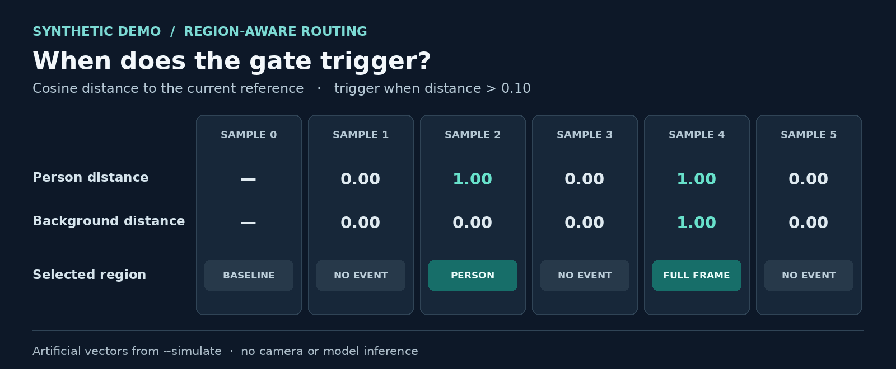
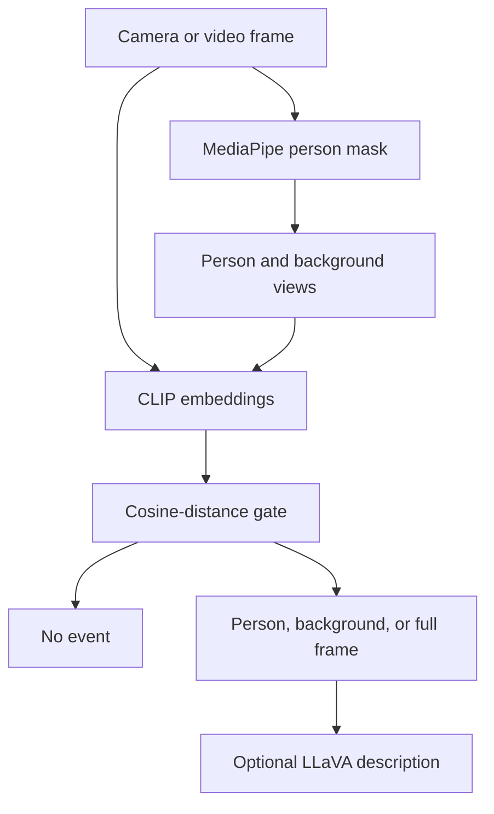

# Event-Triggered Visual Reasoning

**Use changes in the person and background to select when, and what, a vision-language model should inspect.**

For interactive perception, sending every camera frame to a large vision-language model can be unnecessary. This exploratory prototype uses person segmentation and CLIP image embeddings to detect changes in different scene regions, then optionally routes the selected image to LLaVA.

`Vision-language models` · `CLIP` · `MediaPipe` · `LLaVA` · `Change detection`



*Output of the included `--simulate` demo using artificial vectors. This visual illustrates the gate's logic; it is not a camera recording, model inference result, or benchmark.*

In this example, sample 0 initializes the reference. A person-only change triggers at sample 2, while simultaneous person and background changes select the full frame at sample 4. Repeating the same embeddings does not trigger another event.

## Pipeline



Each sampled frame is encoded as a full image, a person-only image, and a background-only image. Masked pixels are black. The gate compares each region embedding with its stored reference using cosine distance:

$$
d_r = 1 - \frac{e_r \cdot e_r^{\mathrm{ref}}}{\lVert e_r \rVert \cdot \lVert e_r^{\mathrm{ref}} \rVert}
$$

The first sample sets the references. Person and background distances determine the route when they are greater than a threshold; the full-frame distance is reported for context.

| Person changed | Background changed | Selected input |
| --- | --- | --- |
| No | No | No event |
| Yes | No | Person view |
| No | Yes | Background view |
| Yes | Yes | Full frame |

After an event, the affected region reference is updated. A full-frame event refreshes both region references, preventing repeated triggers on unchanged inputs. LLaVA is called only if `--vlm` is enabled and an event is selected. It receives the **current selected image**, not a before-and-after pair, so its response does not directly compare frames.

## Try the synthetic demo

The gate and its tests run without downloading models. Python 3.10 or 3.11 is recommended.

```powershell
py -3.11 -m venv .venv
.\.venv\Scripts\Activate.ps1
python -m pip install --upgrade pip
python -m pip install -e .
vision-events --simulate
python -m unittest discover -s tests -v
```

On macOS or Linux, activate with `source .venv/bin/activate` instead. Each line of the demo is a JSON record containing the selected region and synthetic distances.

## Try a camera or video

For CUDA, first install compatible PyTorch and torchvision builds using the [official PyTorch selector](https://pytorch.org/get-started/locally/), then install the optional dependencies:

```powershell
python -m pip install -e ".[models]"
vision-events --source 0 --device cuda --every 30 --max-samples 100
```

Use a local video path instead of `0` to process a recording. `--every 30` analyzes every 30th frame; it is not a fixed wall-clock interval. Each analyzed sample produces a JSON record. Omit `--max-samples` for an unlimited run and stop with Ctrl+C. Use `--device cpu` if CUDA is unavailable.

To generate descriptions for selected images, add `--vlm`:

```powershell
vision-events --source 0 --device cuda --every 30 --max-samples 100 --vlm --question "Describe what is visible in this image."
```

The first run downloads the required weights. The optional 7B LLaVA model requires substantial memory and disk space. The default cosine-distance threshold is `0.1`; tune it with `--threshold` for the scene and task. The program does not save camera frames by default.

## Scope and validation

- **What has been checked:** the model-independent gate is tested with synthetic vectors, including separate and simultaneous changes and reference updates.
- **What remains to be checked:** the refactored camera/video and real-model paths have not been verified end to end here. Latency, model-call reduction, missed events, and accuracy have not been measured.
- **Research context:** this is an AI-assisted reconstruction and refactoring of exploratory scripts, separate from the final method of the associated paper. Thresholds, segmentation quality, lighting, occlusion, and VLM errors can affect the behavior.

A useful next evaluation would compare event-triggered routing with regular inference on the same recorded scenes, measuring missed events, response delay, and model calls. [See the project overview](https://artin-saberpour.github.io/projects/event-triggered-vision/).

## Models and acknowledgments

This project uses pretrained third-party components: [MediaPipe Selfie Segmentation](https://github.com/google-ai-edge/mediapipe), [CLIP](https://github.com/openai/CLIP) via [`openai/clip-vit-base-patch32`](https://huggingface.co/openai/clip-vit-base-patch32), and optional [LLaVA](https://github.com/haotian-liu/LLaVA) via [`llava-hf/llava-1.5-7b-hf`](https://huggingface.co/llava-hf/llava-1.5-7b-hf). Model interfaces use [Hugging Face Transformers](https://huggingface.co/docs/transformers/). Review upstream code, model, and data licenses before reuse.
